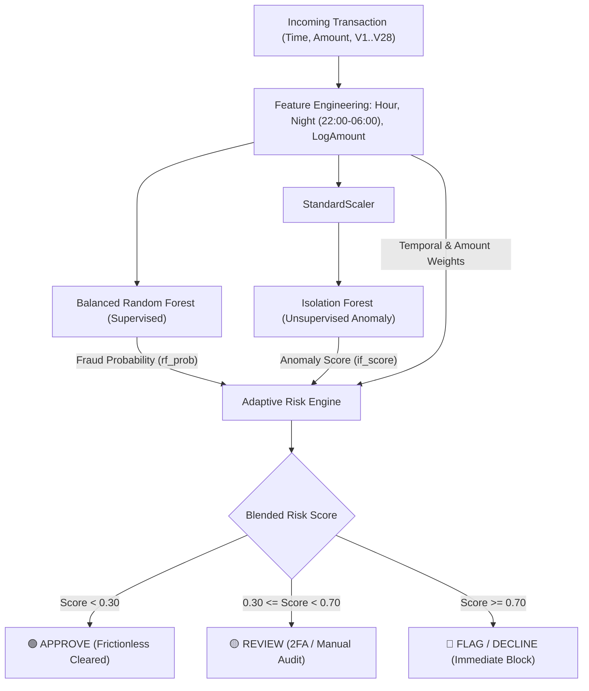

# 🛡️ Credit Card Fraud Detection & Adaptive Risk Analysis

[](https://fastapi.tiangolo.com)
[](https://react.dev)
[](https://tailwindcss.com)
[](https://python.org)
[](https://opensource.org/licenses/MIT)

> An enterprise-grade, hybrid AI-powered credit card fraud detection and adaptive risk analysis platform built with **FastAPI**, **React 18**, and a dual **Supervised + Unsupervised Machine Learning** pipeline.

---

## 🌟 Key Features

- **⚡ Dual-Engine Hybrid ML Pipeline**:
  - **Balanced Random Forest (Supervised)**: Learns confirmed fraud patterns using balanced bootstrap bagging, achieving **99.89% Accuracy** and **87.76% Fraud Recall** on extreme imbalanced data.
  - **Isolation Forest (Unsupervised Anomaly Detector)**: Trained exclusively on legitimate spending behavior to detect zero-day anomalies and novel spending geometries.
  - **Adaptive Risk Engine**: Dynamically shifts decision weights between supervised pattern recognition and anomaly detection based on model uncertainty, nocturnal hours (`22:00 - 06:00`), and elevated monetary amounts.
- **💻 Interactive Professional Dashboard (React 18)**:
  - **Real-Time Transaction Simulator**: Live risk index meter (`0% - 100%`), interactive sliders for Amount, Time/Hour, and Key PCA dimensions (`V1`–`V28`).
  - **One-Click Real Case Presets**: Instantly load confirmed frauds, normal daily spending, and synthetic night-time anomalies from the dataset.
  - **Explainable AI (XAI) Diagnostics**: Plain-English bullet diagnostics explaining exactly why a transaction was **APPROVED**, sent to **REVIEW**, or **FLAGGED**.
  - **Multi-Currency Support**: Native dataset amounts are in Euros (€), with live toggleable conversions for **INR (₹)**, **USD ($)**, **EUR (€)**, and **GBP (£)**.
  - **Batch Stream Analyzer**: Evaluates high-throughput transaction streams with automated queue triage and breakdown charts.
- **🚀 Ultra-Fast FastAPI Backend**:
  - Sub-millisecond response latency with Swagger / OpenAPI documentation available at `/docs`.
  - Fully asynchronous with CORS support for microservices and payment gateways.

---

## 🏗️ Architecture Overview



---

## 📊 Model Performance Metrics

Evaluated on **`56,961`** stratified holdout test transactions from the Kaggle Credit Card dataset:

| Metric | Score | Detail |
| :--- | :--- | :--- |
| **Accuracy** | **`99.89%`** | Reliable classification across massive transaction volume |
| **Fraud Recall** | **`87.76%`** | Successfully caught **86 of 98** confirmed frauds |
| **Precision** | **`61.87%`** | Controlled false alarm rate on extreme class imbalance (`0.17%` positive rate) |
| **F1-Score** | **`0.7257`** | Optimal harmonic balance |
| **Frauds Intercepted** | **`90.8%`** | **81.6%** immediately blocked + **9.2%** routed to review queue |

---

## 🚀 Quickstart Guide

### 1. Prerequisites
- Python 3.10 or newer
- Git

### 2. Clone and Setup
```bash
git clone https://github.com/shreyajayaraman26-alt/credit-card-dectection-n-risk-analysis09.git
cd credit-card-dectection-n-risk-analysis09
pip install -r requirements.txt
```

### 3. Model Training
To train or retrain the hybrid ML pipeline on `data/creditcard.csv`:
```bash
python train.py
```
*(Pre-trained model bundle is included in `models/trained_models.pkl`)*

### 4. Run the Application
Launch the FastAPI backend and React frontend:
```bash
python main.py
```

Open your browser:
- **Web Dashboard**: [http://127.0.0.1:8000](http://127.0.0.1:8000)
- **Interactive Swagger API Docs**: [http://127.0.0.1:8000/docs](http://127.0.0.1:8000/docs)

---

## 🔌 REST API Endpoints

| Method | Endpoint | Description |
| :--- | :--- | :--- |
| `GET` | `/` | Serves the interactive React Single Page Application |
| `GET` | `/api/health` | Health check & model loaded verification |
| `GET` | `/api/model-info` | Evaluation metrics, feature lists, and score thresholds |
| `GET` | `/api/sample-transactions` | Pre-cached real fraud and legitimate sample cases |
| `POST` | `/api/score` | Scores a single transaction with XAI diagnostics |
| `POST` | `/api/batch-score` | Evaluates a simulated batch stream of transactions |

### Sample `POST /api/score` Payload
```json
{
  "Time": 406.0,
  "Amount": 1809.68,
  "V1": -2.31,
  "V2": 1.95,
  "V3": -1.60,
  "V4": 3.99,
  "V14": -4.28
}
```

### Sample Response:
```json
{
  "rf_fraud_probability": 0.2956,
  "if_anomaly_score": 0.4361,
  "rf_weight": 0.3740,
  "if_weight": 0.6260,
  "risk_score": 0.3836,
  "risk_level": "MEDIUM",
  "action": "REVIEW",
  "engineered_features": {
    "Hour": 0.11,
    "LogAmount": 7.5015,
    "Night": 1
  },
  "explanations": [
    "Supervised RF fraud probability is 29.6% (model weight: 37%)",
    "Unsupervised IF anomaly score is 43.6% (model weight: 63%)",
    "Blended adaptive risk score is 38.4% -> Recommended Action: REVIEW",
    "Transaction occurred during high-risk overnight hours (22:00 - 06:00)."
  ]
}
```

---

## 📁 Repository Structure

```
credit-card-dectection-n-risk-analysis09/
├── app.py                     # FastAPI REST API application & React server
├── main.py                    # Server launch entry point
├── train.py                   # Model training, validation & evaluation pipeline
├── requirements.txt           # Python dependencies (FastAPI, Uvicorn, NumPy, Pydantic)
├── risk_decisions.csv         # Sample evaluated holdout test decisions
├── static/
│   └── index.html             # React 18 + Tailwind CSS frontend dashboard
├── src/
│   ├── __init__.py            # Module root exports
│   ├── preprocessing.py       # Data cleaning, scaling, and stratified splitting
│   ├── feature_engineering.py # Hour, Night, and LogAmount transformations
│   ├── random_forest.py       # Supervised Balanced Random Forest classifier
│   ├── isolation_forest.py    # Unsupervised Anomaly Isolation Forest
│   └── risk_engine.py         # Adaptive weighting and XAI explanations
├── models/
│   └── trained_models.pkl     # Exported model weights and pipeline bundle
└── data/
    └── creditcard.csv         # Kaggle credit card transaction dataset
```

---

## 📜 License
This project is licensed under the MIT License - open for educational, academic, and commercial application.
