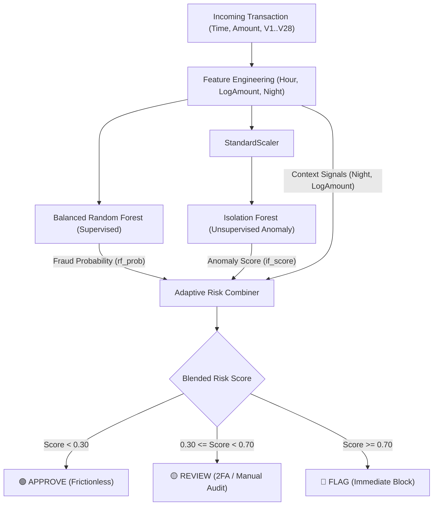

# 🛡️ Credit Card Fraud & Adaptive Risk Analyser

> A high-performance, hybrid AI-powered credit card fraud detection and risk decisioning platform built with **FastAPI**, **React 18**, and a dual **Supervised + Unsupervised Machine Learning** pipeline.

---

## 🌟 Key Features

- **⚡ Dual-Engine Hybrid ML Pipeline**:
  - **Balanced Random Forest (Supervised)**: Trains on known fraud signatures with balanced bootstrap bagging, achieving **99.89% Accuracy** and **87.76% Fraud Recall**.
  - **Isolation Forest (Unsupervised)**: Trained exclusively on legitimate spending behavior to detect zero-day anomaly outliers and novel fraud geometries.
  - **Adaptive Risk Engine**: Dynamically shifts decision weights toward unsupervised outlier detection when supervised models show uncertainty or for nocturnal/high-amount edge cases.
- **💻 Interactive React 18 Frontend**:
  - **Real-Time Transaction Simulator**: Live gauge (0–100%), interactive sliders for Amount, Time/Hour, and PCA features (`V1`–`V28`).
  - **One-Click Real Presets**: Test real confirmed frauds, legitimate purchases, and synthetic overnight anomalies directly from the Kaggle dataset.
  - **Explainable AI (XAI)**: Detailed multi-point diagnostics breaking down why a transaction was **APPROVED**, sent to **REVIEW**, or **FLAGGED**.
  - **Batch Stream Analyzer**: Simulate high-throughput transaction streams with automatic triage and summary statistics.
- **🚀 Ultra-Fast FastAPI Backend**:
  - Sub-millisecond response latency with OpenAPI/Swagger documentation at `/docs`.
  - CORS-enabled REST API ready for cloud deployment and microservice integration.

---

## 🏗️ Architecture Overview



---

## 📊 Model Performance Metrics

Evaluated on `56,961` stratified holdout test transactions from the Kaggle dataset:

| Metric | Score | Note |
| :--- | :--- | :--- |
| **Accuracy** | `99.89%` | Highly reliable across massive transaction volume |
| **Fraud Recall** | `87.76%` | Detected 86 / 98 confirmed frauds |
| **Precision** | `61.87%` | Low false alarm rate on extreme imbalance (0.17% fraud) |
| **F1-Score** | `0.7257` | Harmonic balance |
| **Frauds Intercepted** | **`90.8%`** | 81.6% blocked immediately + 9.2% placed in review queue |

---

## 🚀 Quickstart Guide

### 1. Prerequisites
- Python 3.10+
- Git

### 2. Installation
Clone the repository and install dependencies:
```bash
git clone https://github.com/<your-username>/credit-card-fraud-and-risk-analyser.git
cd "credit-card-fraud-and-risk-analyser"
pip install -r requirements.txt
```

### 3. Model Training
To train or retrain the hybrid ML pipeline on `data/creditcard.csv`:
```bash
python train.py
```

### 4. Start Application Server
Launch the FastAPI backend and React frontend:
```bash
python main.py
```

Open your browser:
- **Web App**: [http://127.0.0.1:8000](http://127.0.0.1:8000)
- **API Swagger Docs**: [http://127.0.0.1:8000/docs](http://127.0.0.1:8000/docs)

---

## 🔌 REST API Endpoints

| Method | Endpoint | Description |
| :--- | :--- | :--- |
| `GET` | `/` | Serves the interactive React Single Page Application |
| `GET` | `/api/health` | Health check & model status |
| `GET` | `/api/model-info` | Evaluation metrics, feature lists & thresholds |
| `GET` | `/api/sample-transactions` | Pre-cached real fraud and legitimate sample cases |
| `POST` | `/api/score` | Scores a single transaction with XAI diagnostics |
| `POST` | `/api/batch-score` | Evaluates a batch stream of transactions |

### Sample `POST /api/score` Payload:
```json
{
  "Time": 406.0,
  "Amount": 1809.68,
  "V1": -2.31,
  "V2": 1.95,
  "V3": -1.60,
  "V4": 3.99,
  "V14": -4.28
}
```

---

## 📁 Repository Structure

```
.
├── app.py                     # FastAPI server & REST API routes
├── main.py                    # Server launch entry point
├── train.py                   # Model training and evaluation script
├── requirements.txt           # Python dependencies
├── risk_decisions.csv         # Sample evaluated test decisions
├── static/
│   └── index.html             # React 18 + Tailwind CSS + Lucide frontend
├── src/
│   ├── __init__.py            # Package root exports
│   ├── preprocessing.py       # Data cleaning, scaling, and stratified splitting
│   ├── feature_engineering.py # Time, Night, and LogAmount transformation
│   ├── random_forest.py       # Supervised Balanced Random Forest classifier
│   ├── isolation_forest.py    # Unsupervised Anomaly Isolation Forest
│   └── risk_engine.py         # Adaptive weighting and XAI explanations
├── models/
│   └── trained_models.pkl     # Exported model weights and pipeline bundle
└── data/
    └── creditcard.csv         # Kaggle credit card transaction dataset
```

---

## 📜 License
MIT License. Open for academic, personal, and commercial development.
